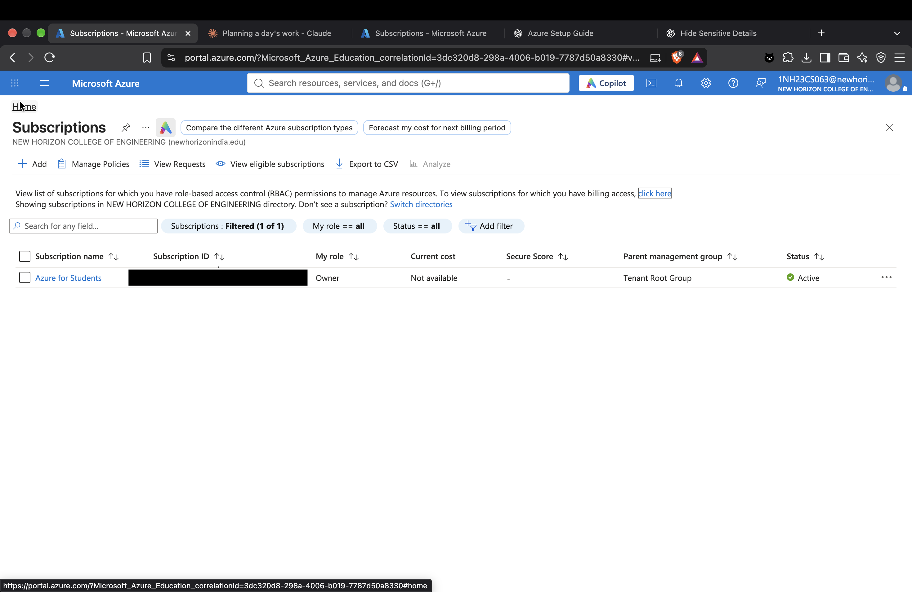
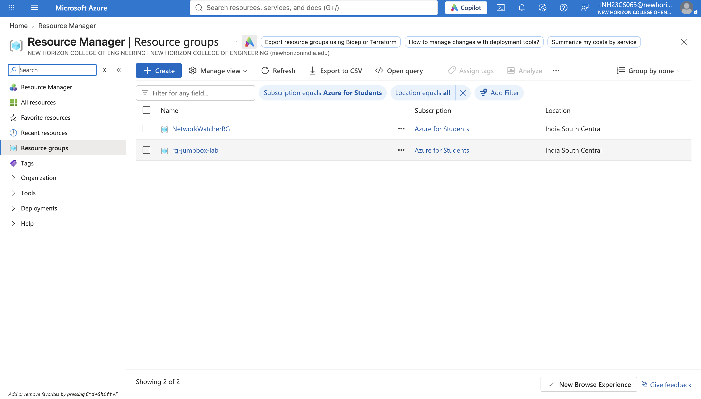
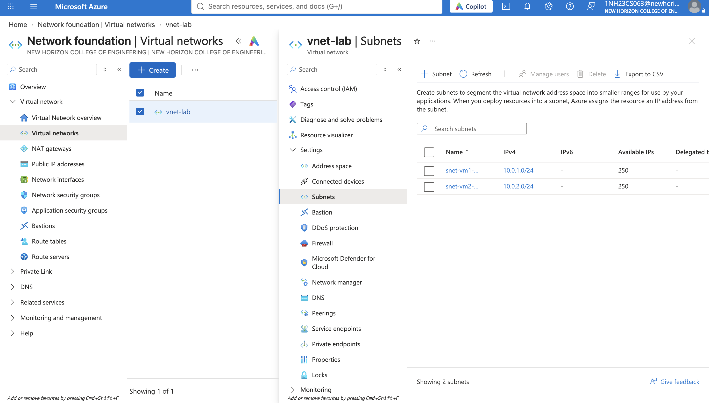
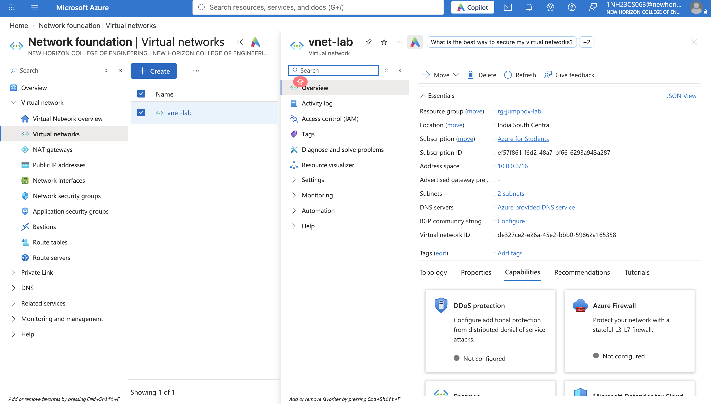

# Azure Secure Jump Box Infrastructure

This project provisions a small Azure lab environment with:

- 1 resource group
- 1 virtual network with two subnets
- 1 public Windows jump box VM
- 1 private Linux VM accessible only from the jump box
- Network security groups with restricted inbound access

## Architecture

- `vm1` is the public Windows VM used as the jump host.
- `vm2` is private-only and has no public IP.
- SSH access to `vm2` is allowed only from the private IP of `vm1`.
- The public VM has RDP enabled only from your laptop IP.

## Files

- `main.tf` — Terraform configuration for the infrastructure
- `variables.tfvars.example` — example values for the required variables
- `.gitignore` — ignores Terraform state and local cache files
- `LICENSE` — project license
- `Screenshots/` — screenshots of the lab setup and resources

## Prerequisites

Before deploying, make sure you have:

- Azure CLI installed and logged in
- A valid Azure subscription
- Terraform installed
- Your laptop public IPv4 address

## Login to Azure

```bash
az login
az account set --subscription "<your-subscription-name-or-id>"
```

## Fill required Terraform variables

You must provide values for the following variables when running Terraform:

- `my_ip`
- `admin_password`

A ready-to-copy example is available in [`variables.tfvars.example`](variables.tfvars.example).

```hcl
location = "centralindia"
my_ip = "49.37.12.34"
vm_size = "Standard_B2s"
admin_username = "azureadmin"
admin_password = "YourStrongPassword123!"
```

Example command:

```bash
cp variables.tfvars.example terraform.tfvars
terraform init
terraform plan
```

## Deploy

```bash
terraform apply \
  -var="my_ip=49.37.12.34" \
  -var="admin_password=YourStrongPassword123!"
```

## Optional: custom region or VM size

You can override defaults in the Terraform variables section:

```bash
terraform apply \
  -var="location=centralindia" \
  -var="vm_size=Standard_B1ms" \
  -var="my_ip=49.37.12.34" \
  -var="admin_password=YourStrongPassword123!"
```

## Outputs

After deployment, Terraform will print:

- `vm1_public_ip`
- `vm2_private_ip`

## Notes

- `my_ip` should be your actual public IP without a `/32` suffix.
- `admin_password` must meet Azure password rules.
- The configuration intentionally keeps `vm2` private to model a secure bastion/jump-box architecture.

## License

This project is licensed under the [MIT License](LICENSE).

## Screenshots


Figure 1: Resource group and networking layout for the secure jump-box lab.


Figure 2: Subnet segmentation for the public jump box and private Linux VM.


Figure 3: NSG rule view showing restricted RDP and SSH access.


Figure 4: Summary of the Azure VM resources created by Terraform.

## Cleanup

```bash
terraform destroy \
  -var="my_ip=49.37.12.34" \
  -var="admin_password=YourStrongPassword123!"
```
